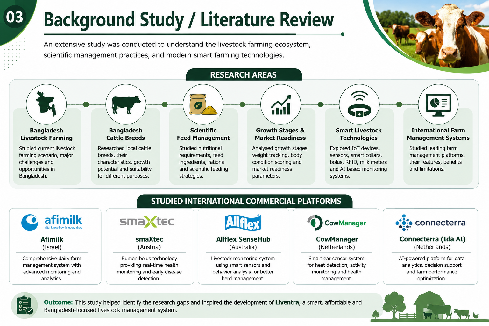
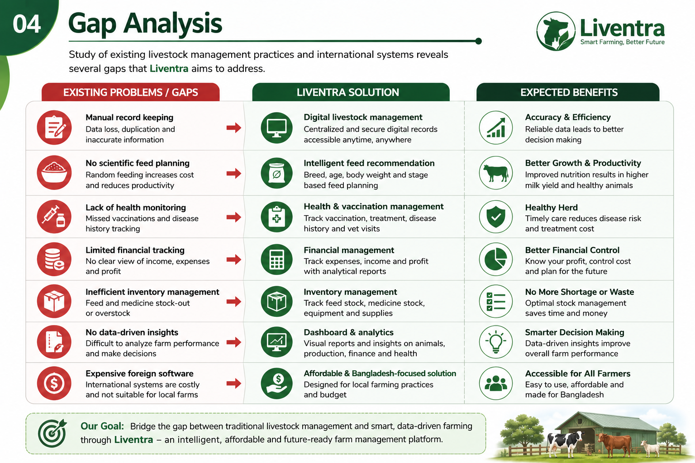
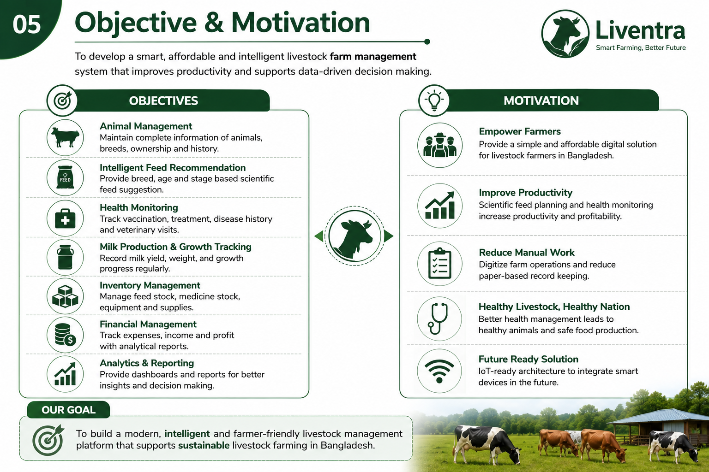
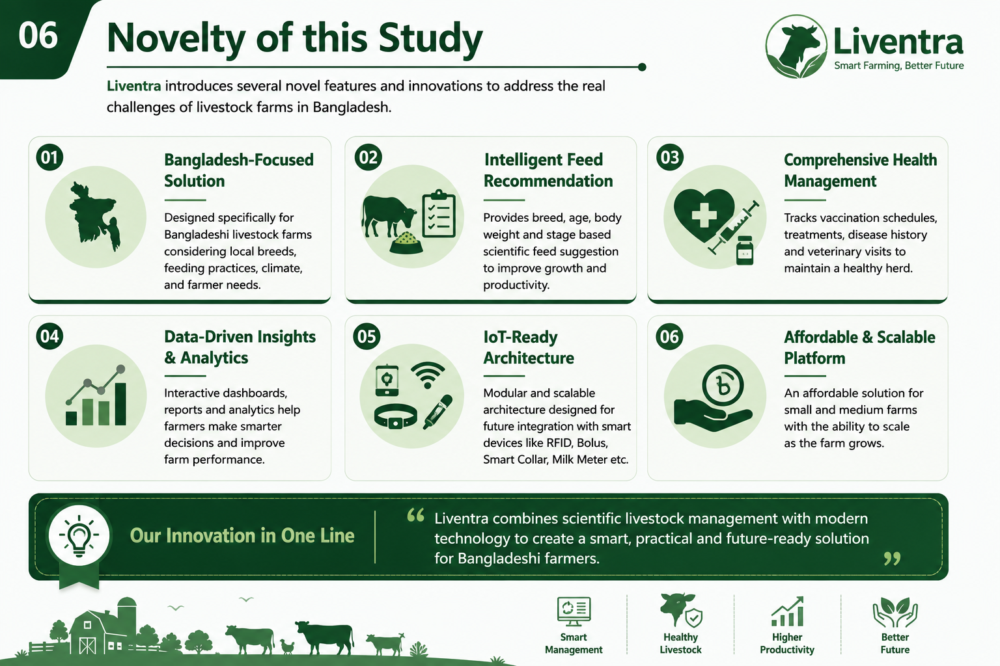

# Slide 1
## Liventra
### A Smart Livestock Farm Management System with Intelligent Feed Recommendation and Health Monitoring for Bangladesh

**Presented By**

**Name**  
ID: XXXXXXXX

**Team Member Name**  
ID: XXXXXXXX

**Supervisor**
Mr./Ms. XXXXXXXXXX

Department of Computer Science & Engineering (CSE)

Daffodil International University

Phase-I Evaluation
# Slide 2
## Introduction

### Why this Project?

• Bangladesh's livestock sector is an important contributor to food security and the national economy.

• Most livestock farms still rely on manual record-keeping and traditional farm management practices.

• Farmers often face difficulties in feed planning, vaccination tracking, health monitoring, inventory management, and financial record keeping.

• Existing international livestock management systems are expensive and not designed for Bangladeshi farming practices.

• Liventra aims to provide an affordable, intelligent, and digital livestock management solution specifically designed for Bangladesh.

> **Speaker Notes (40 seconds)**
Bangladesh is one of the leading agricultural countries where livestock farming plays an important role. However, most farms still manage animal information manually. This leads to inefficient feed management, poor health monitoring, and financial losses. Our project, Liventra, aims to solve these problems through a smart web-based management platform.

# Slide 3
## Background Study / Literature Review

### Research Areas

• Bangladesh Livestock Farming Practices

• Bangladesh Cattle Breeds

• Scientific Feed Management

• Growth Stages & Market Readiness

• Smart Livestock Technologies

• International Farm Management Systems

### Existing Commercial Platforms

• Afimilk (Israel)

• smaXtec (Austria)

• Allflex SenseHub

• CowManager

• Connecterra (Ida AI)

> **Speaker Notes**
During Phase-I, we conducted extensive research on Bangladesh's livestock sector and studied leading smart farming platforms used worldwide. We analyzed their technologies, features, and limitations to identify opportunities for a localized solution.

# Slide 4
## Gap Analysis

| Existing Problems | Liventra Solution |
|-------------------|-------------------|
| Manual record keeping | Digital livestock management |
| No scientific feed planning | Intelligent feed recommendation |
| No centralized health records | Vaccination & health monitoring |
| Limited financial tracking | Expense & profit analytics |
| Expensive foreign software | Affordable Bangladesh-focused solution |
| No future IoT support | IoT-ready modular architecture |

> **Speaker Notes**
Although international farm management platforms provide advanced features, they are expensive and mainly designed for large commercial farms. Liventra is designed specifically for Bangladeshi farmers, focusing on affordability, simplicity, and future scalability.
# Slide 5
## Objective & Motivation

### Objectives

• Digitize livestock farm management

• Develop intelligent feed recommendation

• Monitor animal health and vaccination

• Track milk production and animal growth

• Manage inventory and financial records

• Generate analytical reports for better decision-making

### Motivation

To develop an affordable and intelligent livestock management platform that addresses the practical needs of Bangladeshi dairy and livestock farms.

> **Speaker Notes**
Our main objective is not just to digitize farm records but also to assist farmers in making better decisions through scientific feed management, health monitoring, and analytical reporting.
# Slide 6
## Novelty of this Study

### Key Innovations

• Bangladesh-focused livestock management platform

• Breed-based intelligent feed recommendation

• Growth-stage-based feeding strategy

• Modular and scalable system architecture

• Future-ready IoT integration (RFID, Bolus, Smart Collar)

• MERN-based modern web application

> **Speaker Notes**
The novelty of our work lies in combining livestock management with scientific feeding practices while keeping the software affordable and suitable for local farms. Unlike many existing systems, our architecture is also designed for future integration with smart livestock devices.
# Slide 7
## Datasets, Tools & Technologies

### Research Sources

• BLRI

• Department of Livestock Services (DLS)

• Bangladesh Agricultural University (BAU)

• FAO Guidelines

• NRC Dairy Nutrition Standards

• Research Articles

### Development Technologies

• MongoDB

• Express.js

• React.js

• Node.js

### Future Device Support

• RFID

• Bolus Sensor

• Smart Collar

• Milk Meter
> **Speaker Notes**
Our project combines verified livestock knowledge with modern web technologies. The system is designed using the MERN stack while keeping the architecture ready for future IoT integration.
# Slide 8
## Proposed Methodology

Problem Identification

↓

Literature Review

↓

Requirement Analysis

↓

Software Requirement Specification (SRS)

↓

System Design

↓

Database Design

↓

MERN Development

↓

Testing & Validation

↓

Final Deployment
> **Speaker Notes**
Our methodology follows a structured software engineering approach. During Phase-I, we completed the research, requirement analysis, and initial system planning. The next phase will focus on design and implementation.
# Slide 9
## Expected Outcomes

• Complete Digital Livestock Management System

• Intelligent Feed Recommendation Module

• Animal Health Monitoring

• Inventory & Financial Management

• Interactive Dashboard & Reports

• Improved Farm Decision-Making

• IoT-ready Software Architecture

• Scalable MERN-based Web Application
> **Speaker Notes**
At the end of the project, Liventra will provide a complete digital solution for livestock farms. It will improve productivity, simplify daily farm operations, and provide a foundation for future smart farming technologies.
# Slide 10
## Thank You

### Questions & Discussion

**Liventra**

*Smart Livestock Farm Management System for Bangladesh*